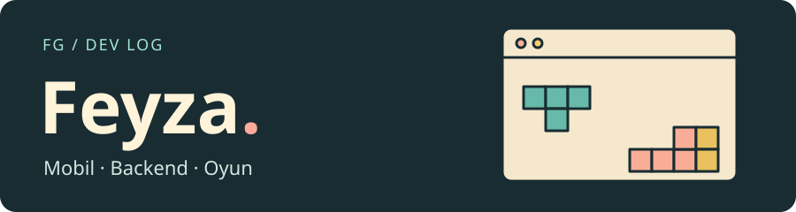

## 👋 Merhaba, ben Feyza!

Bir gün YouTube’daki bir dersi kısa notlara dönüştüren bir asistan, başka bir gün Tetris oynayarak besleyebildiğin bir sanal evcil hayvan geliştiriyorum. Burada mobil uygulamalarımı, Python ile yazdığım servisleri ve C# masaüstü projelerimi bulabilirsin.

## 🧰 Araç kutum

| Kod yazarken | Uygulamaya dönüştürürken |
| :--- | :--- |
|  **Dart** | Flutter ile mobil arayüzler, Flame ile oyun sahneleri |
|  **Python** | FastAPI ile mobil uygulama ve tarayıcı eklentilerine servisler |
|  **C#** | Windows Forms ile masaüstü uygulamaları |
|  **SQL** | SQL Server ile kayıt, sorgulama ve raporlama |

## 🕹️ Proje seç

**[🎬 Öğrenci Video Asistanı](https://github.com/fgencay/AI-YouTube-Learning-Assistant)** · Python, FastAPI, Flutter  
Bir ders videosundan not ve mini test üretir. Analizi Chrome eklentisinden başlatıp sonuçları mobil uygulamada görebilirsin.

**[🐾 Sanal Evcil Hayvan](https://github.com/fgencay/pou_game)** · Dart, Flutter, Flame  
Karakterini seç, mutfağa geç ve yemeğini sürükleyerek ver. Tetris’te temizlediğin satırlar, evcil hayvanının bakımında harcayabileceğin coin’lere dönüşür.

**[🗝️ Pansiyon Yönetim Sistemi](https://github.com/fgencay/pansiyonv3)** · C#, Windows Forms, SQL Server  
Dokuz odalı bir pansiyonun resepsiyon ve kasa işlemlerini bir araya getirir: oda seçimi, konaklama ücretinin hesaplanması ve gelir-gider takibi.
